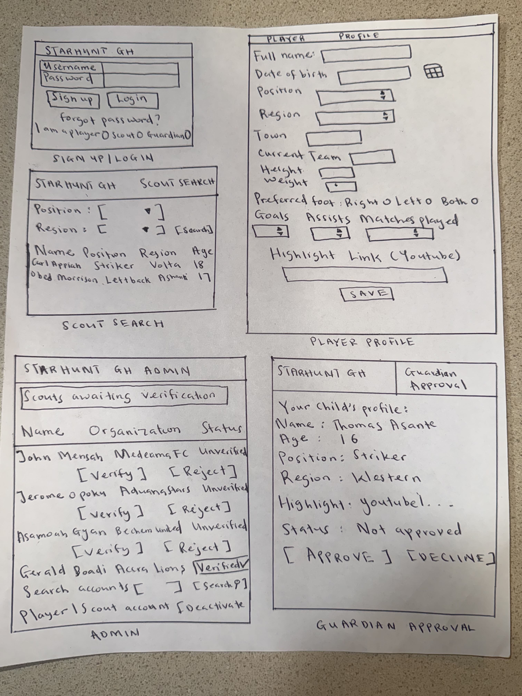
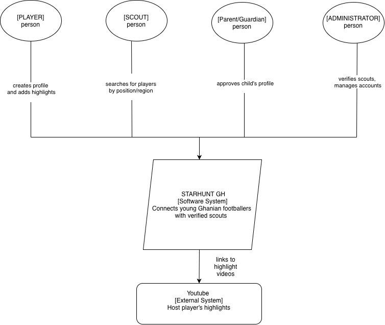

# StarHunt Gh Design Documents

## User Stories

### User Story-1: Create a player profile
As a **young football player**, I want to **build a profile with my personal data and football background** so I can **be recognized by scouts and coaches**.

**Acceptance criteria**
- A player can register with a username and password.
- The profile form needs a full name, date of birth, position, region, and preferred foot.
- Position and region are picked from fixed lists (10 positions, 16 Ghana regions).
- Town, current team, height, weight, goals, assists, and number of matches played can also be added.
- After saving, the player can access and edit their own profile.

### User Story-2: Share highlight videos
As a **young football player**, I want to **add a link to my highlight video** so I can **show scouts what I can do on the pitch**.

**Acceptance criteria**
- A player can add a highlight link to their profile.
- Only YouTube links (youtube.com or youtu.be) are accepted.
- Any other link is declined with the message "Please enter a valid YouTube link for your highlights."

### User Story-3: Search for players
As a **scout**, I want to **look for players by region and position** so I can **find talent that fits my team's needs**.

**Acceptance criteria**
- A scout can filter players by any of the 10 positions.
- A scout can filter players by any of the 16 regions of Ghana.
- Both filters can be used together (e.g. strikers in Ashanti).
- Results will show each player's name, position, region, and age.

### User Story-4: Approve a minor's profile
As a **parent or guardian**, I want to **approve my child's profile before scouts can see it** so I can **make sure my child has protection**.

**Acceptance criteria**
- Players below the age of 18 start with their profile marked as not approved.
- Profiles that are not approved are not visible in scout searches.
- Once approved, the profile appears in scout searches.

### User Story-5: Verify scouts
As an **administrator**, I want to **verify that each scout is authorized before they can search for players** so I can **protect players from fake agents and frauds**.

**Acceptance criteria**
- New scout accounts start as unverified.
- Unverified scouts cannot search or view player profiles.
- Only an administrator can mark a scout as verified.

### User Story-6: Manage the platform
As an **administrator**, I want to **review, edit, and remove player and scout accounts** so I can **keep the platform legitimate and safe**.

**Acceptance criteria**
- Only administrators can access the admin panel.
- An administrator can search and filter player profiles.
- An administrator can deactivate any account that breaks the rules and regulations.

## Mis-user Scenarios 

### Mis-user Scenario 1: Scammer pretending to be an agent
As a **fake agent**, I want to **pose as a scout** so I can **contact young players and scam them or their families**.

**Mitigation criteria**
- New scout accounts start as unverified.
- Unverified scouts will not be able to search or view player profiles.
- Only an administrator can verify a scout.
- Player contact details are never shown to unverified scouts.

### Mis-user Scenario 2: Brute force login 
As an **attacker**, I want to **brute-force a player's password by trying many combinations** so I can **take over their account**.

**Mitigation criteria**
- Passwords must be at least 8 characters and cannot be common passwords (Django password validators).
- Passwords are stored hashed, never in plain text.
- Login errors do not reveal whether the username exists.
- An account is locked out for a period of time after repeated failed logins.

### Mis-user Scenario 3: Editing someone else's profile
As a **malicious user**, I want to **change another player's profile** so I can **mess up their stats or change their highlight link**.

**Mitigation criteria**
- Each profile is connected to exactly one user account.
- A player can only access the edit page for their own profile.
- Requests to edit another player's profile are rejected.
- Only administrators can alter any profile.

### Mis-user Scenario 4: Malicious highlight link
As an **attacker**, I want to **post a harmful website as my highlight link** so I can **trick scouts into visiting a phishing or malware site**.

**Mitigation criteria**
- Only links starting with https://www.youtube.com/ or https://youtu.be/ are accepted.
- Any other link is rejected with the message "Please enter a valid YouTube link for your highlights."
- The check runs on the server, so it cannot be skipped by editing the page in the browser.

### Mis-user Scenario 5: Script injection
As an **attacker**, I want to **put a script in my profile name or team field** so I can **steal the session of any scout who views my profile**.

**Mitigation criteria**
- All text entered by users is escaped before it is shown on a page (Django template auto-escaping stays on).
- Text fields have maximum lengths.
- Position, region, and preferred foot only accept values from fixed lists.

### Mis-user Scenario 6: Stealing secrets from the code
As an **attacker**, I want to **find passwords or secret keys in the public GitHub repo** so I can **break into the database or forge logins**.

**Mitigation criteria**
- The database password and Django secret key are stored in a .env file, not in the code.
- The .env file is listed in .gitignore and never committed.
- The repo only includes .env.example, which contains placeholder values.

## Architecture Diagrams
 
 ### Context Diagram
 